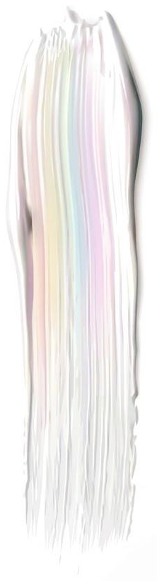
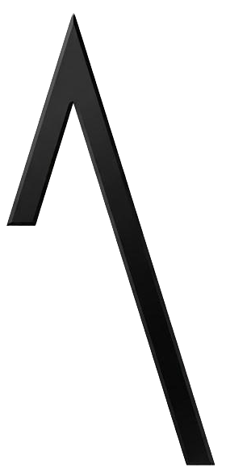
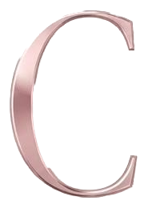

# Logo AC animado

Animação em CSS (sem vídeo, sem JavaScript), feita a partir de
`entrada/logo_vectorial.jpeg`. Camadas recortadas com a PhotoCraft.

Sequência, cerca de 3 segundos, uma vez ao carregar a página:

1. o traço iridescente pinta-se de cima para baixo e fica depois a cintilar,
   como madrepérola (variação de cor lenta, contínua);
2. o Λ desenha-se a partir do vértice;
3. o C entra a deslizar e recebe um reflexo de luz no ouro rosa.

Quem tem "reduzir movimento" ativo no sistema vê o logo final, sem animação.

## Ficheiros

| Ficheiro | O que é |
|---|---|
| `index.html` | página de demonstração, com botão para repetir a animação |
| `logo-animado.css` | toda a animação |
| `camadas/traco.png` | o traço, com fundo branco (ver nota abaixo) |
| `camadas/lambda.png` | o Λ, fundo transparente |
| `camadas/c.png` | o C, fundo transparente |

## Vídeos para redes sociais (pasta `video/`)

Feitos com a EffectCraft, a mesma sequência, fundo branco, 6 s (animação em
3,5 s e o logo parado até ao fim), 30 fps, H.264:

| Ficheiro | Para |
|---|---|
| `logo-ac-1080x1080.mp4` | feed do Instagram, Facebook, LinkedIn |
| `logo-ac-1080x1920.mp4` | Reels, Stories, TikTok, Shorts |

`logo-ac.jsx` é o script que monta o projeto (`logo-ac.ecproj`). Para mudar
tempos, cores ou tamanhos: editar o script e voltar a correr

```bash
effectcraft-cli script logo-ac.jsx --empty --save-as logo-ac.ecproj
effectcraft-cli render --project logo-ac.ecproj --comp "AC quadrado 1080" --out logo-ac-1080x1080.mp4 --format h264
effectcraft-cli render --project logo-ac.ecproj --comp "AC vertical 1080x1920" --out logo-ac-1080x1920.mp4 --format h264
```

## Pôr no site

1. Copiar `logo-animado.css` e a pasta `camadas/` para o site, lado a lado.
2. No `<head>`: `<link rel="stylesheet" href="logo-animado.css">`
3. Onde o logo deve aparecer:

```html
<div class="ac-logo" role="img" aria-label="Logótipo AC">
  
  
  <div class="ac-c"><span class="ac-brilho"></span></div>
</div>
```

Se as imagens ficarem noutra pasta, mudar os `src` acima **e** o
`url("camadas/c.png")` dentro do CSS (é a máscara do reflexo).

## Ajustar

No início do `logo-animado.css`, em `.ac-logo`:

- **tamanho:** `width: min(320px, 80vw);` — mudar o 320px;
- **velocidade:** `--ac-dur: 1;` — 1.5 fica 50% mais lento, 0.7 mais rápido.

## Nota: fundo do site

O traço é quase todo branco, como o fundo do logo original, e não se deixa
recortar automaticamente. Por isso vai com o fundo branco e usa
`mix-blend-mode: multiply`, que torna o branco invisível. Resultado: fica
perfeito em fundos **brancos ou claros**. Num fundo escuro o traço aparece
dentro de um retângulo branco; para isso seria preciso recortá-lo à mão (ou
pedir uma versão de fundo escuro do logo ao designer).
